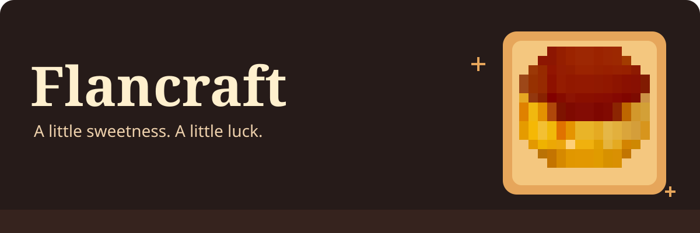

<p align="center">
  
</p>

<p align="center">
  <strong>A dessert-sized Fabric mod for Minecraft.</strong><br>
  Make caramel, whip up custard, and turn your next build into something sweet.
</p>

<p align="center">
  <a href="https://github.com/violetradd/flancraft/releases">Releases</a> ·
  <a href="https://www.youtube.com/watch?v=HpFZEUT9jQU">Watch the showcase</a> ·
  <a href="https://github.com/violetradd/flancraft/issues">Bugs &amp; ideas</a>
</p>

---

## Meet the menu

| | On the menu | What it brings |
| :---: | :--- | :--- |
|  | **Flan** | The star of the show. Restores 6 hunger points and has a **50% chance to grant Luck for 5 minutes**. |
|  | **Caramel** | A quick, sweet snack and the finishing touch for flan. |
|  | **Custard** | A creamy snack that becomes the base of your dessert. |
|  | **Evaporated milk** | Stock your pantry for dessert crafting. |
|  | **Condensed milk** | Another essential for your crafting-table kitchen. |
|  | **Vanilla extract** | Bring a little vanilla to your recipes. |
|  | **Vanilla bean** | Search jungle temples, abandoned mineshafts, and dungeons to find it. |

### Build something delicious

**Flan blocks** and **custard blocks** bring the dessert counter to your builds. Try a bakery display, a candy-colored cottage, or an entire room made of custard. Both blocks can be crafted back into their matching desserts.

## Your first flan

Put **3 caramel** above **3 custard** in a crafting table:

| | | |
| :---: | :---: | :---: |
| Caramel | Caramel | Caramel |
| Custard | Custard | Custard |

**Makes 1 flan.** Take a bite and try your luck.

## Get cooking

1. Install [Fabric Loader](https://fabricmc.net/use/installer/) **0.16.10 or newer** for your Minecraft version.
2. Add a matching [Fabric API](https://modrinth.com/mod/fabric-api) `.jar` to your Minecraft `mods` folder.
3. Get the Flancraft mod `.jar` from [Releases](https://github.com/violetradd/flancraft/releases), if one is available, and put it in the same folder. If there is no packaged release, use the build instructions below.
4. Launch Minecraft with your Fabric profile. Dessert is served.

> **Version notes:** The source currently builds against **Minecraft 1.21** and requires **Java 21**. Mod metadata allows the 1.21 series; the original README listed 1.21.1. Choose a release and Fabric API that match your game version.

## From source, with sugar

With **JDK 21** installed, clone this repository and run:

```sh
git clone https://github.com/violetradd/flancraft.git
cd flancraft
./gradlew build
```

On Windows, use `gradlew.bat build`. The mod is written to `build/libs/`; use the `.jar` without the `-sources` suffix.

## Pull up a chair

Have a dessert idea or found something broken? [Open an issue](https://github.com/violetradd/flancraft/issues) or send a pull request. For bug reports, include your Minecraft version, Fabric Loader version, and any relevant logs.

Made by **Violet Radd** · Released into the public domain under [The Unlicense](LICENSE).
